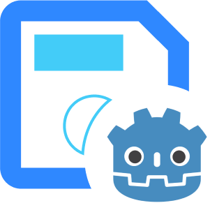
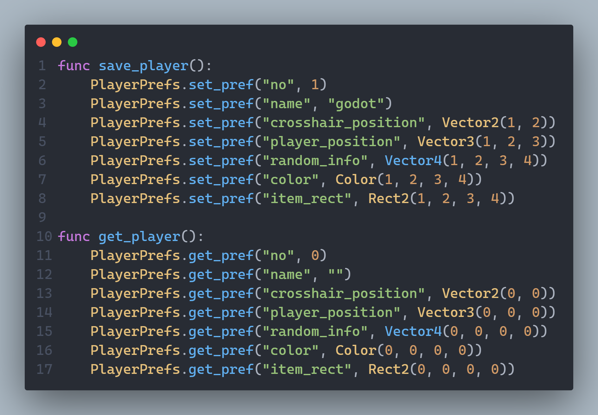
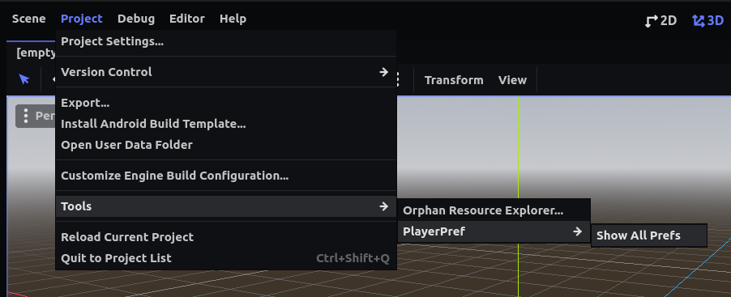

# PlayerPrefs

<!-- centre image  -->
<p align="center">
  
</p>

## Description

This is a simple class that allows you to save and load data in a file. It is very easy to use and it is very useful for saving game data.

Features:
- Unity-style key/value preferences saved to `user://prefs.save`
- Atomic writes with automatic `.bak` backup and recovery
- Multiple save slots / profiles
- Save versioning with migration callback
- Save-on-write, autosave timer, save on quit/pause
- JSON export/import for debugging
- Editor dock panel to inspect and edit preferences



## Installation

1. Copy the `addons/PlayerPrefs` folder into your project's `addons/` folder.
2. Enable the plugin in **Project Settings > Plugins**. The `PlayerPrefs` autoload singleton is registered automatically.

## How to use

### Save data
```gdscript
# Save individual data
func save_player():
	PlayerPrefs.set_pref("no", 1)
	PlayerPrefs.set_pref("name", "godot")
	PlayerPrefs.set_pref("crosshair_position", Vector2(1, 2))
	PlayerPrefs.set_pref("player_position", Vector3(1, 2, 3))
	PlayerPrefs.set_pref("random_info", Vector4(1, 2, 3, 4))
	PlayerPrefs.set_pref("color", Color(1, 2, 3, 4))
	PlayerPrefs.set_pref("item_rect", Rect2(1, 2, 3, 4))

# Save complete information
func set_player_base():
	var player = {"no": 1,
		"score": 0,
		"crosshair_position": Vector2(1, 2),
		"player_position": Vector3(1, 2, 3),
		"random_info": Vector4(1, 2, 3, 4),
		"color": Color(1, 2, 3, 4),
		"item_rect": Rect2(1, 2, 3, 4)}

	PlayerPrefs.set_base(player)
```

### Querying data
```gdscript
PlayerPrefs.has_pref("no")          # true / false
PlayerPrefs.get_keys()              # all stored keys
PlayerPrefs.get_all()               # a deep copy of all prefs
PlayerPrefs.delete_pref("no")       # remove one key
PlayerPrefs.delete_all()            # remove everything
```

### Typed getters
```gdscript
PlayerPrefs.get_int("no", 0)
PlayerPrefs.get_float("volume", 1.0)
PlayerPrefs.get_string("name", "")
PlayerPrefs.get_bool("muted", false)
PlayerPrefs.get_vec2("crosshair_position", Vector2.ZERO)
PlayerPrefs.get_vec3("player_position", Vector3.ZERO)
PlayerPrefs.get_vec4("random_info", Vector4.ZERO)
PlayerPrefs.get_color("color", Color.WHITE)
PlayerPrefs.get_rect2("item_rect", Rect2())
PlayerPrefs.get_array("inventory", [])
PlayerPrefs.get_dictionary("settings", {})
```
Each getter falls back to its default value when the key is missing or holds a different type.

### Signals
Whenever preferences are changed, signals are emitted:

```gdscript
PlayerPrefs.prefs_changed.connect(_on_prefs_changed)   # (key, value)
PlayerPrefs.pref_deleted.connect(_on_pref_deleted)     # (key)
PlayerPrefs.prefs_cleared.connect(_on_prefs_cleared)   # ()
PlayerPrefs.save_failed.connect(_on_save_failed)       # (path)
PlayerPrefs.prefs_loaded.connect(_on_prefs_loaded)     # ()
PlayerPrefs.slot_changed.connect(_on_slot_changed)     # (slot_name)

func _on_prefs_changed(key, value):
	print("Prefs changed:- ", key, " : ", value)
```

### Load data
```gdscript
func get_player():
	PlayerPrefs.get_pref("no", 0)
	PlayerPrefs.get_pref("name", "")
	PlayerPrefs.get_pref("crosshair_position", Vector2(0, 0))
	PlayerPrefs.get_pref("player_position", Vector3(0, 0, 0))
	PlayerPrefs.get_pref("random_info", Vector4(0, 0, 0, 0))
	PlayerPrefs.get_pref("color", Color(0, 0, 0, 0))
	PlayerPrefs.get_pref("item_rect", Rect2(0, 0, 0, 0))

func get_player_base():
	PlayerPrefs.get_base()
```

### Save behavior
```gdscript
PlayerPrefs.save_on_write = true        # default: save after every change
PlayerPrefs.save_on_write = false       # batch changes, save manually:
PlayerPrefs.save_data()                 # returns true on success

PlayerPrefs.autosave_interval = 60.0    # optional periodic autosave (seconds)
PlayerPrefs.autosave_on_quit = true     # default: save on app close / pause
PlayerPrefs.load_data()                 # reload from disk (returns bool)
```

### Save slots
```gdscript
PlayerPrefs.set_slot("profile2")        # switch to prefs_profile2.save
PlayerPrefs.get_active_slot()           # "profile2"
PlayerPrefs.list_slots()                # ["", "profile2", ...]
PlayerPrefs.delete_slot("profile2")     # remove the slot's files
```

### Versioning & migration
```gdscript
PlayerPrefs.save_version = 2            # bump when data meaning changes
PlayerPrefs.migration_callback = _migrate

func _migrate(old_prefs: Dictionary, from_version: int) -> Dictionary:
	if from_version < 2:
		old_prefs["new_key"] = old_prefs.get("old_key", 0)
	return old_prefs
```

### JSON export/import
```gdscript
PlayerPrefs.export_json("user://prefs_debug.json")   # readable backup
PlayerPrefs.import_json("user://prefs_debug.json")   # restore (returns bool)
```

### Check Data
Use the **PlayerPrefs editor dock** (left panel) to view, add, edit and delete
preferences, switch slots, and export/import JSON without running the game.
The **PlayerPref > Log All Prefs** editor menu prints the current save file.


It will print the data in the console.
